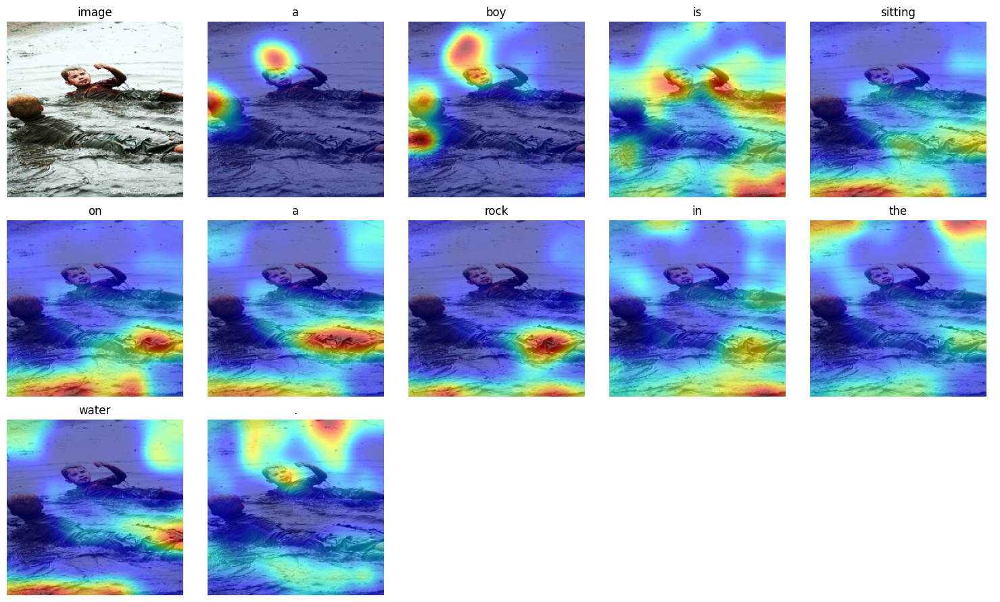
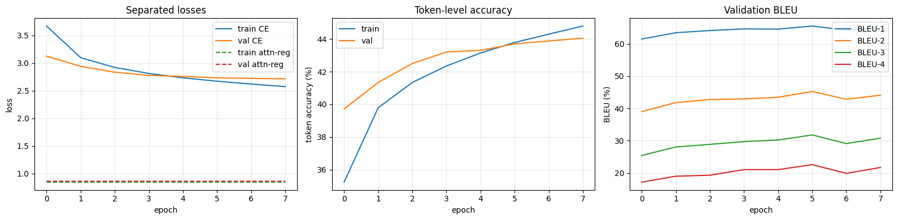
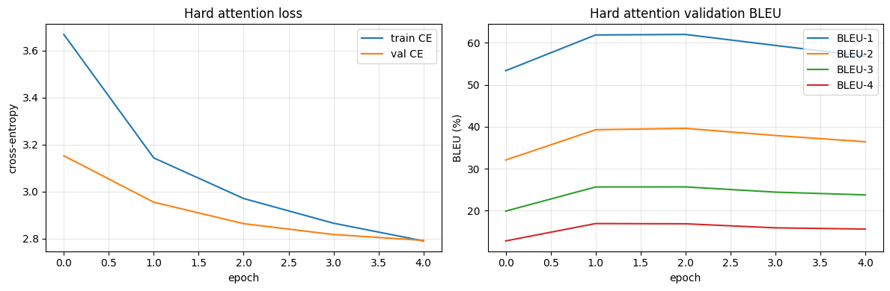
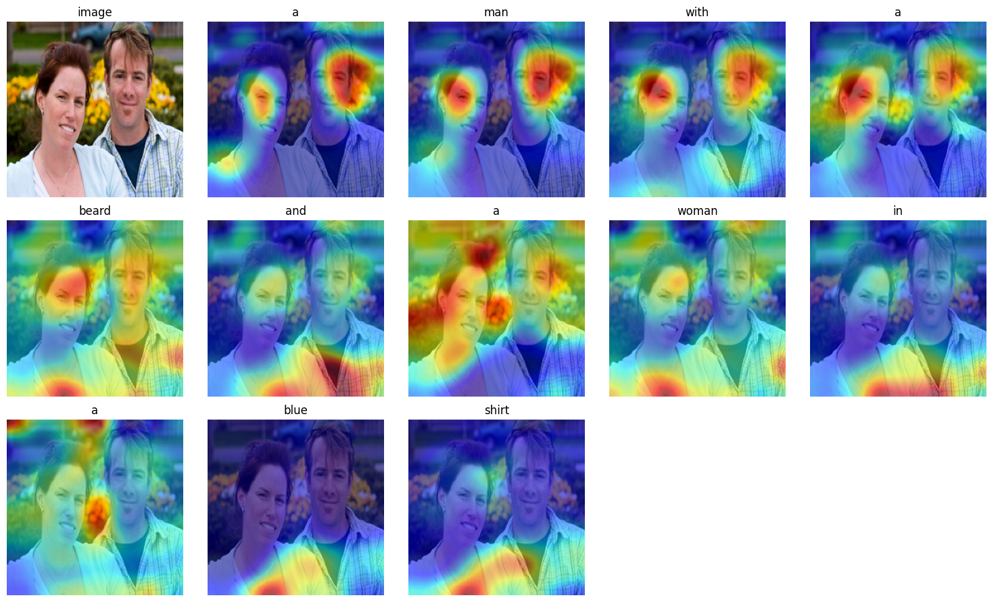
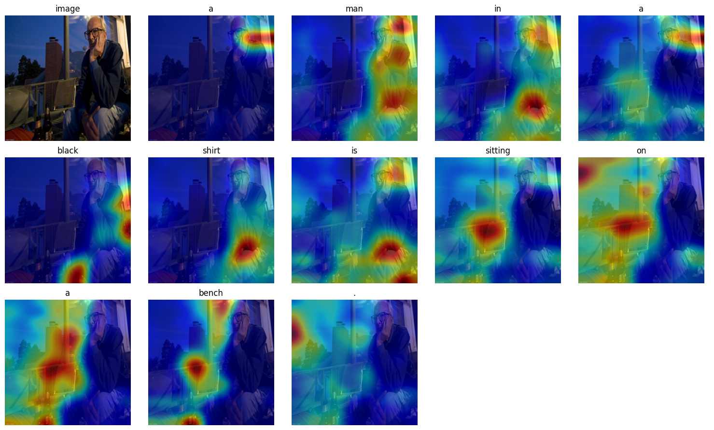
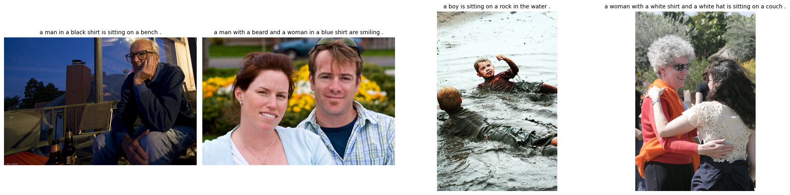
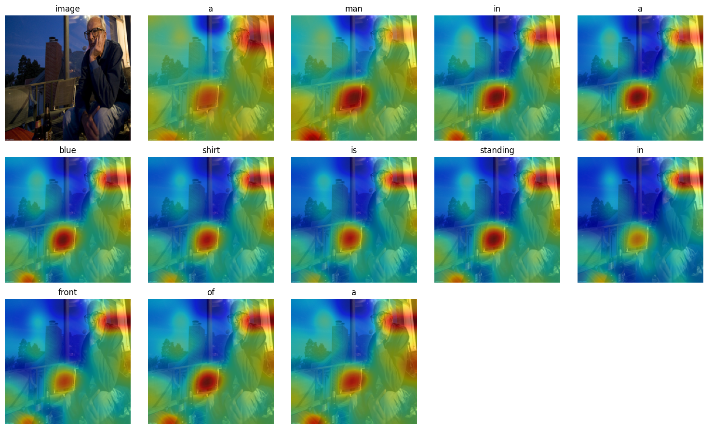
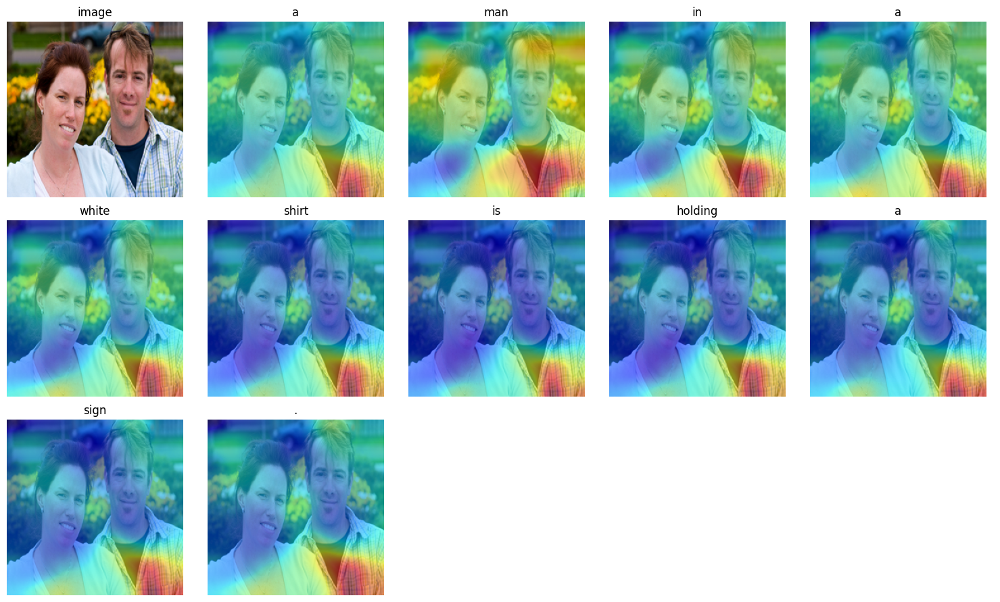
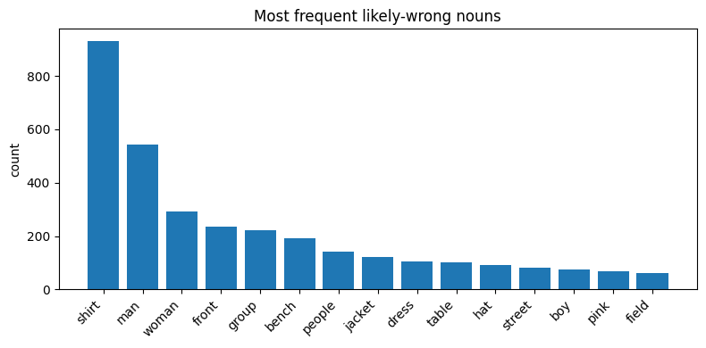
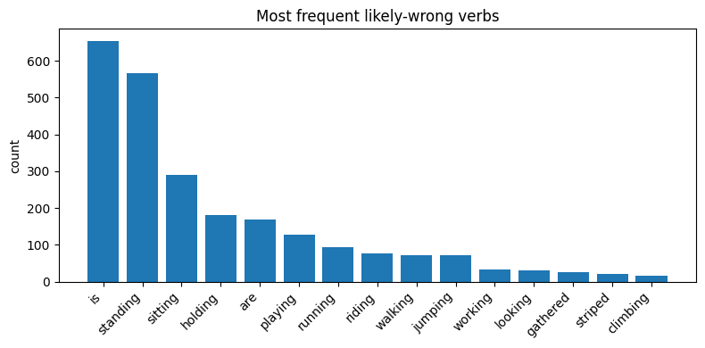

<div align="center">

# Show, Attend and Tell — a Flickr30k Reproduction

**Neural image captioning with soft and hard visual attention, reproduced in PyTorch**

[](https://arxiv.org/abs/1502.03044)
[](https://www.python.org/)
[](https://pytorch.org/)
[](https://www.kaggle.com/)
[](https://www.kaggle.com/datasets/adityajn105/flickr30k)
[](LICENSE)

*Deep learning class project by **Ayoub Rebhi, Mahmoud Ben Khelil, Medali Mraihi, Molka Boukhris, Semah Ayachi and Yassine Maazaoui***

</div>

---

We reproduced **"Show, Attend and Tell: Neural Image Caption Generation with Visual Attention"**
(Xu et al., ICML 2015) on **Flickr30k**, implementing both the **soft (deterministic)** and the
**hard (stochastic)** attention models. We then added an error analysis inspired by
**"Reproducing Show, Attend and Tell"** (Liu & Brailsford, 2023).

<div align="center">

| | BLEU-1 | BLEU-2 | BLEU-3 | BLEU-4 |
|---|:---:|:---:|:---:|:---:|
| **Our soft attention** (test, 3,179 images) | 65.50 | **44.05** | **29.84** | **20.52** |
| Paper, soft attention (Table 1) | **66.7** | 43.4 | 28.8 | 19.1 |

<sub>BLEU is only roughly comparable with the paper (different split, NLTK smoothing, greedy decoding). See <a href="#-results">Results</a>.</sub>



<sub>Soft attention while our model generates <i>"a boy is sitting on a rock in the water ."</i> Each panel shows where the model looks for one word.</sub>

</div>

## 📑 Contents

- [What the paper proposes](#-what-the-paper-proposes)
- [Architecture](#-architecture)
- [What we reproduced](#-what-we-reproduced)
- [Dataset](#-dataset)
- [Results](#-results)
- [Soft vs hard attention](#-soft-vs-hard-attention)
- [Attention visualisations](#-attention-visualisations)
- [Error analysis](#-error-analysis)
- [How to run it on Kaggle](#-how-to-run-it-on-kaggle)
- [Project structure](#-project-structure)
- [References](#-references)

---

## 💡 What the paper proposes

Earlier captioning models (encoder–decoder, such as *Show and Tell*) squeeze the whole image into
**one** vector before the language model starts writing. Xu et al. instead keep a **grid of image
features** and let the decoder **choose where to look at every word**:

- A CNN turns the image into **L = 196 annotation vectors** (a 14 × 14 grid, D = 512 each).
- At each time step, an **attention model** scores the 196 locations against the LSTM state and
  produces weights α (one per location) and a **context vector** ẑ.
- An **LSTM** generates the next word from the context vector, the previous word and its hidden state.

The paper studies two ways of turning α into ẑ:

| | Soft attention | Hard attention |
|---|---|---|
| Context vector | Weighted average of all 196 locations: ẑ = Σᵢ αᵢ aᵢ | **One location sampled** from α (Multinoulli) |
| Training | Plain backpropagation | Variational lower bound / **REINFORCE**, with a moving-average baseline and an entropy term |
| Behaviour | Smooth, spread-out attention | Sharp, discrete "fixations" |

Two extra tricks complete the model: a **gating scalar β = σ(f_β(h))** that scales the visual context at
each step, and a **doubly-stochastic regulariser** λ Σᵢ (1 − Σₜ αₜᵢ)² that encourages the model to
look at every part of the image over the whole caption. Attention also makes the model
**interpretable**: we can plot α to see what the model looked at for each word.

## 🏗️ Architecture

```
            Flickr30k image (224 × 224)
                        │
                        ▼
   VGG19, ImageNet-pretrained, frozen, last max-pool removed
                        │
                        ▼
       14 × 14 × 512 feature map  ──►  196 annotation vectors aᵢ ∈ ℝ⁵¹²
                        │
          ┌─────────────┴─────────────┐   (repeated at every word t)
          ▼                           ▼
   attention MLP  f_att(aᵢ, hₜ₋₁)  ──►  αₜ (softmax over 196 locations)
          │
          ▼
   soft:  ẑₜ = Σᵢ αₜᵢ aᵢ         hard:  ẑₜ = a_s,  s ~ Categorical(αₜ)
          │
          ▼
   β gate:  ẑₜ ← σ(f_β(hₜ₋₁)) · ẑₜ
          │
          ▼
   LSTMCell([E·yₜ₋₁ ; ẑₜ], hₜ₋₁)  ──►  hₜ  ──►  output layer  ──►  next word yₜ
```

| Component | Our setting |
|---|---|
| Encoder | VGG19 (`IMAGENET1K_V1`), frozen, output `[B, 196, 512]` (shape checked in the notebook) |
| LSTM initial state | h₀, c₀ predicted from the mean of the annotation vectors |
| Dimensions | word embedding 256 · LSTM 512 · attention MLP 256 |
| Output layer | soft model: linear layer on the hidden state · hard model: the paper's deep output layer, `Lo·tanh(Lh·h + Lz·ẑ + E·y)` |
| Regularisation | dropout 0.5, doubly-stochastic attention penalty (λ = 1.0) |
| Optimiser | Adam, learning rate 4e-4, gradient clipping at 5.0, batch size 32 |
| Batching | length-based bucketing (each mini-batch has captions of a single length), as in the paper |
| Model selection | early stopping on **validation BLEU-4** (patience 3), as in the paper |
| Decoding | greedy |
| Trainable parameters | 9.0 M (soft decoder) · 9.7 M (hard decoder) · encoder frozen |

## ✅ What we reproduced

| Paper element | Status | Notes |
|---|:---:|---|
| VGG19 encoder, 14 × 14 × 512 features, no fine-tuning | ✅ | Same as the paper |
| Soft deterministic attention | ✅ | |
| Hard stochastic attention (REINFORCE + moving-average baseline + entropy) | ✅ | Plus the paper's trick of using the soft context with probability 0.5 |
| β gating scalar | ✅ | In both decoders |
| Doubly-stochastic regularisation | ✅ | |
| Deep output layer (Eq. 2 of the paper) | ✅ / ⚠️ | Hard model only; the soft model uses a simpler output layer |
| Length-based bucketing | ✅ | |
| Early stopping on validation BLEU | ✅ | Patience is not given in the paper; we used 3 |
| BLEU-1…4 and METEOR on Flickr30k | ⚠️ | NLTK implementations, different split (see below) |
| Attention visualisations | ✅ | Upsampled 14 × 14 maps with Gaussian smoothing |
| Flickr8k and MS COCO | ❌ | Flickr30k only |
| Error analysis of Liu & Brailsford (2023) | ✅ | VGG19 top-5, wrong nouns/verbs, GPT-2 scoring, dependency parsing (YOLO skipped) |

## 📦 Dataset

We used **Flickr30k** ([Kaggle copy by adityajn105](https://www.kaggle.com/datasets/adityajn105/flickr30k)):
31,783 images, each with 5 human captions (158,914 captions in total).

| Split | Images | Captions |
|---|---:|---:|
| Train | 25,426 | 127,129 |
| Validation | 3,178 | 15,890 |
| Test | 3,179 | 15,895 |

- We split **by image** (80 / 10 / 10, `random_state = 42`), so the 5 captions of a picture always stay
  in the same split. This is a **random split, not the Karpathy split** used in the paper (1,000 validation
  and 1,000 test images).
- Captions are lowercased and cleaned. The vocabulary is built from the training captions only
  (minimum frequency 5), giving **6,928 tokens** including `<pad> <start> <end> <unk>`. Captions are
  capped at 30 tokens.
- Training images get a random crop and horizontal flip. All images use ImageNet normalisation.

## 📊 Results

Test set: **3,179 Flickr30k images**, greedy decoding, scores × 100.

| Model | BLEU-1 | BLEU-2 | BLEU-3 | BLEU-4 | METEOR\* |
|---|:---:|:---:|:---:|:---:|:---:|
| **Ours, soft attention** | 65.50 | **44.05** | **29.84** | **20.52** | 39.70\* |
| Paper, soft attention | 66.7 | 43.4 | 28.8 | 19.1 | 18.49 |
| **Ours, hard attention** | 62.53 | 39.50 | 25.17 | 16.42 | 35.09\* |
| Paper, hard attention | **66.9** | 43.9 | 29.6 | 19.9 | 18.46 |

Average generated caption length: 12.04 words (soft), 11.37 words (hard).

> [!IMPORTANT]
> **How to read these numbers**
> - \***Our METEOR is not comparable with the paper's.** We used NLTK's `meteor_score`, which is a
>   different implementation from the official METEOR the paper used and gives much higher values.
>   We report it for completeness only.
> - **BLEU is only roughly comparable.** We used a random 80/10/10 split instead of the Karpathy
>   split, NLTK corpus BLEU with smoothing (`method1`), and greedy decoding. With these caveats, our
>   soft-attention model is **close to the paper**: slightly below on BLEU-1 and slightly above on
>   BLEU-2 to BLEU-4.
> - **Our hard-attention model is below the paper** (BLEU-4 16.42 vs 19.9). We trained it for only
>   5 epochs on a single Kaggle T4. The paper trained for much longer on a Titan Black GPU.

<details>
<summary><b>Training curves and per-epoch numbers</b></summary>

<br>

Validation BLEU during training is computed on a **fixed subset of 200 validation images** (same
seed every epoch). This is used for early stopping only and is not comparable with the test numbers.

**Soft attention**: 8 epochs, about 20 min each. The best checkpoint is from **epoch 6**.

| Epoch | 1 | 2 | 3 | 4 | 5 | 6 | 7 | 8 |
|---|---|---|---|---|---|---|---|---|
| Val cross-entropy | 3.126 | 2.942 | 2.835 | 2.778 | 2.760 | 2.734 | 2.723 | 2.716 |
| Val BLEU-4 | 17.15 | 18.98 | 19.30 | 21.02 | 21.03 | **22.58** | 19.87 | 21.70 |



**Hard attention**: 5 epochs, about 22 min each. The best checkpoint is from **epoch 2**, and
early stopping triggered at epoch 5.

| Epoch | 1 | 2 | 3 | 4 | 5 |
|---|---|---|---|---|---|
| Val cross-entropy | 3.153 | 2.955 | 2.864 | 2.818 | 2.793 |
| Val BLEU-4 | 12.81 | **16.95** | 16.89 | 15.93 | 15.63 |



The hard model's validation loss keeps decreasing while its BLEU-4 falls after epoch 2. The paper
reports a similar breakdown between log-likelihood and BLEU, which is why it selects models on BLEU.

</details>

## ⚖️ Soft vs hard attention

Both models were evaluated on the **same 3,179 test images**.

| | Soft attention | Hard attention |
|---|---|---|
| Test BLEU-4 | **20.52** | 16.42 |
| Training signal | Cross-entropy + attention penalty | Cross-entropy + attention penalty + REINFORCE (reward = mean log-probability of the reference caption) + entropy bonus (0.01), baseline momentum 0.9 |
| Epochs (time on a T4) | 8 (~2.7 h) | 5 (~1.8 h) |
| Main strength | Stable, fully differentiable, easy to train | Discrete, more human-like fixations |
| Main limitation | Spreads attention over all regions | Sampling is not differentiable, so gradients are high-variance |

In our runs, soft attention was clearly easier to train. The paper reports the two variants as almost
tied on Flickr30k. The gap we see is most likely due to the short training of the hard model. The
comparison is also not strictly like-for-like, because the two decoders use different output layers
(see [Architecture](#-architecture)).

## 👁️ Attention visualisations

For each generated word, we upsample the 14 × 14 attention map to the image size, smooth it with a
Gaussian filter and overlay it on the picture. Red means high attention.

**Soft attention**: *"a man with a beard and a woman in a blue shirt are smiling ."*



<details>
<summary><b>More soft-attention examples</b></summary>

<br>

*"a man in a black shirt is sitting on a bench ."* (reference: *"an elderly man is sitting near a window,
with several bottles of beer in front of him."*)



Generated captions for four random test images (mean β gate between 0.59 and 0.65, printed in the notebook):



</details>

<details>
<summary><b>Hard-attention examples</b></summary>

<br>

At inference, the hard model takes the **most likely location** (argmax) at each step.

*"a man in a blue shirt is standing in front of a building ."*



*"a man in a white shirt is holding a sign ."*



The hard model's maps change very little from one word to the next. After only 5 epochs, its
attention has mostly settled on one fixed region (in the second example, the man's shirt, even for *"sign"*). This fits its lower BLEU scores and suggests
it needs longer training to learn word-specific fixations.

</details>

**What we see:** the soft model moves its attention across the image as the caption progresses.
For example, it looks near the children's heads for *"boy"* and at the water surface for *"rock"*
and *"water"*, while attention for function words (*a*, *the*, *is*) is more spread out. The maps
also expose mistakes. In the top example the model describes one boy on a rock, while the image
shows two boys lying in muddy water.

## 🔍 Error analysis

Following Liu & Brailsford (2023), we asked **why** the model gets captions wrong, using four tools.

**1. What does the encoder see? (VGG19 top-5 ImageNet labels)**

| Test image | Our caption | VGG19 top-5 |
|---|---|---|
| 2981487425 | a man in a black shirt is sitting on a bench . | laptop, guillotine, notebook, crossword puzzle, solar dish |
| 3534512991 | a man with a beard and a woman in a blue shirt are smiling . | sunscreen, ice lolly, ear, rapeseed, hair spray |
| 2674784195 | a boy is sitting on a rock in the water . | coho, sturgeon, bathing cap, sea lion, swimming trunks |

The ImageNet classes rarely match the caption vocabulary (ImageNet has no "person" class, for
example). They do show what the frozen features capture, though: for the third image the encoder
mostly "sees" water and swimming, not two children. When the visual features miss an object, the
decoder can still write a fluent caption around the wrong content.

**2. Likely-wrong nouns and verbs.** Over all 3,179 test captions of the soft model, a noun or verb
counts as *likely wrong* when it appears in the generated caption but in none of the 5 references.

<table>
<tr>
<td></td>
<td></td>
</tr>
</table>

| | Our top-5 | Liu & Brailsford (2023) |
|---|---|---|
| Nouns | shirt (930), man (544), woman (292), front (235), group (221) | shirt, man, woman, bench, field |
| Verbs | is (654), standing (567), sitting (290), holding (182), are (169) | stand, jump, run |

The overlap is striking. *Shirt*, *man*, *woman* and *bench* (6th for us) are at the top of both
lists, and *running* and *jumping* are in our top 10 verbs. The model over-predicts the most frequent
concepts of Flickr captions, a language prior learned from the data. Note that our list also contains
auxiliaries (*is*, *are*), which the NLTK POS tagger labels as verbs, and *front* from the frequent
phrase *"in front of"*.

**3. GPT-2 fluency scoring.** We scored captions with GPT-2 (score = 1 / language-model loss). For
*"a man is sleeping on a bench ."* the generated caption scores 0.207, between its two references
(0.267 and 0.196). Fluency is not the problem; a fluent caption can still be visually wrong.

**4. Typed dependency parsing (spaCy).** The generated captions parse into clean subject–verb–object
structures (e.g. *man* ←nsubj— *sleeping* —prep→ *on* —pobj→ *bench*). The model's errors are
about **content**, not grammar.

*YOLO object detection was planned but skipped because the package and weights were not available
in our Kaggle session.*

## 🚀 How to run it on Kaggle

> [!NOTE]
> **The trained weights are not included in this repository.** They were not kept after the Kaggle
> session. All the results and figures above are saved in the notebook outputs. You can retrain both
> models with the notebook in about **4.5 hours on a Kaggle T4** (soft ~2.7 h + hard ~1.8 h).

1. On Kaggle, create a new notebook and use **File → Import Notebook** to upload
   [`notebooks/show_attend_tell_flickr30k.ipynb`](notebooks/show_attend_tell_flickr30k.ipynb).
2. **Add Input →** the [Flickr30k dataset](https://www.kaggle.com/datasets/adityajn105/flickr30k).
   The notebook searches `/kaggle/input/` for a folder containing `Images/` and `captions.txt`, so
   the exact mount path does not matter.
3. In the settings, choose **Accelerator: GPU T4** and turn **Internet on**. Internet is needed for the
   VGG19 weights, the NLTK data, GPT-2 and the spaCy model.
4. Optionally, edit the runtime controls in Section 1.5:
   - `DEBUG_MODE = True` runs the pipeline quickly on a small subset;
   - `RUN_HARD_ATTENTION = False` trains only the soft model.
5. **Run All.** The checkpoints (`best_model.pth`, `best_hard_attention_model.pth`), the vocabulary,
   the predictions, the metrics and the figures are written to `/kaggle/working/`.

To run it elsewhere, install the dependencies with `pip install -r requirements.txt` (plus
`python -m spacy download en_core_web_sm` for the dependency parser) and change the dataset search
path in Section 2.

<details>
<summary><b>Files produced by a full run</b></summary>

<br>

| File | Content |
|---|---|
| `best_model.pth` | Soft-attention checkpoint (~113 MB) |
| `best_hard_attention_model.pth` | Hard-attention checkpoint (~116 MB) |
| `vocab.json` | Word ↔ index mapping |
| `training_history.csv`, `hard_attention_training_history.csv` | Per-epoch losses and BLEU |
| `test_caption_predictions.csv` | Soft-model caption for every test image |
| `evaluation_results.json` | Soft-model test metrics |
| `model_comparison_results.csv` | Soft vs hard test metrics |
| `paper_vs_notebook_comparison.csv` | What matches the paper and what is simplified |
| `attention_visualizations/` | Attention-map PNGs |

</details>

## 📁 Project structure

```
sat-project/
├── README.md
├── LICENSE                         MIT
├── SPEC.md                         project spec, plan and change log
├── requirements.txt
├── notebooks/
│   └── show_attend_tell_flickr30k.ipynb   full pipeline, with outputs from our Kaggle run
└── docs/
    ├── figures/                    figures exported from the notebook outputs
    │   ├── dataset_sample_image.png
    │   ├── soft_training_curves.png
    │   ├── soft_sample_captions.png
    │   ├── soft_attention_<image_id>.png      (3 examples)
    │   ├── hard_training_curves.png
    │   ├── hard_attention_<image_id>.png      (2 examples)
    │   └── error_analysis_wrong_{nouns,verbs}.png
    └── cell_explanations/          our study notes, cell by cell
```

The notebook is organised in sections: data (1–6), soft-attention model, training and evaluation
(7–11), error analysis (13), hard attention (17–19), and a paper-vs-notebook comparison (20–21).

## 📚 References

1. **K. Xu, J. Ba, R. Kiros, K. Cho, A. Courville, R. Salakhutdinov, R. Zemel, Y. Bengio.**
   *Show, Attend and Tell: Neural Image Caption Generation with Visual Attention.*
   ICML 2015, PMLR 37:2048–2057.
   [arXiv:1502.03044](https://arxiv.org/abs/1502.03044) ·
   [PMLR](https://proceedings.mlr.press/v37/xuc15.html)
2. **H. Liu, T. Brailsford.** *Reproducing "Show, Attend and Tell: Neural Image Caption Generation
   with Visual Attention".* Journal of Physics: Conference Series 2589 (2023) 012012, open access.
   [doi:10.1088/1742-6596/2589/1/012012](https://doi.org/10.1088/1742-6596/2589/1/012012)
3. P. Young, A. Lai, M. Hodosh, J. Hockenmaier. *From image descriptions to visual denotations.*
   TACL 2014 (the Flickr30k dataset).
4. K. Simonyan, A. Zisserman. *Very Deep Convolutional Networks for Large-Scale Image Recognition.*
   [arXiv:1409.1556](https://arxiv.org/abs/1409.1556) (VGG19).

```bibtex
@inproceedings{xu2015show,
  title     = {Show, Attend and Tell: Neural Image Caption Generation with Visual Attention},
  author    = {Xu, Kelvin and Ba, Jimmy and Kiros, Ryan and Cho, Kyunghyun and Courville, Aaron
               and Salakhutdinov, Ruslan and Zemel, Richard and Bengio, Yoshua},
  booktitle = {Proceedings of the 32nd International Conference on Machine Learning},
  series    = {PMLR},
  volume    = {37},
  pages     = {2048--2057},
  year      = {2015}
}

@article{liu2023reproducing,
  title   = {Reproducing ``Show, Attend and Tell: Neural Image Caption Generation with Visual Attention''},
  author  = {Liu, Haixia and Brailsford, Tim},
  journal = {Journal of Physics: Conference Series},
  volume  = {2589},
  number  = {1},
  pages   = {012012},
  year    = {2023},
  doi     = {10.1088/1742-6596/2589/1/012012}
}
```

---

<div align="center">
<sub>Class project · Released under the <a href="LICENSE">MIT License</a> · The papers are linked, not redistributed.</sub>
</div>
